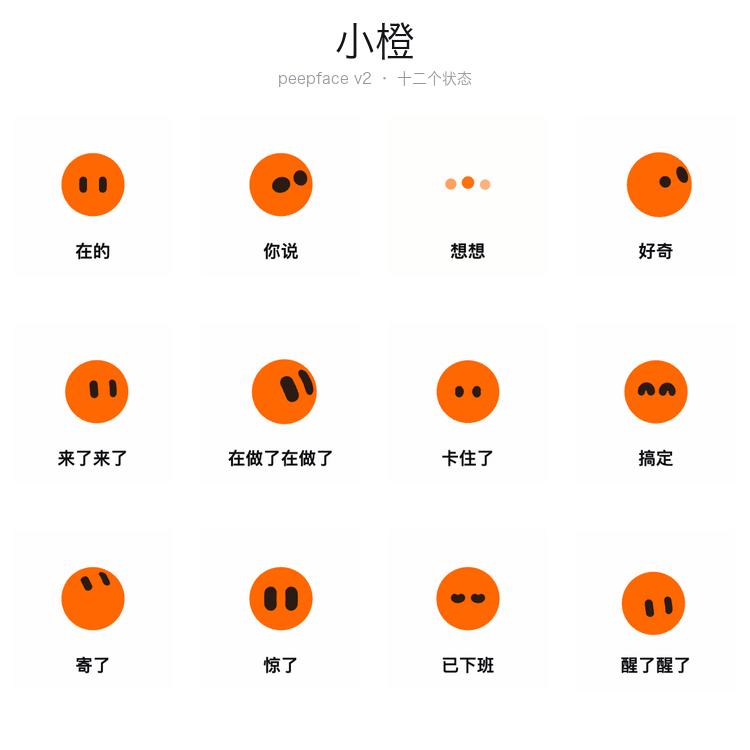

# peepface

**一张会表达状态的脸。26 种形状、任意颜色、22 个状态，一行 `sync()` 接上任何 agent。**

```js
import { createFace } from 'peepface';

const face = createFace('#face', { shape: 'sphere', color: '#FF6700' });

face.sync({ running: true, composing: false, activity: { tool: 'read_file' } });
// → 脸变成「在读文件」
```

---



---

## 为什么是「状态」而不是「动画」

大多数 AI 头像是一个循环 GIF —— 它不知道自己在干什么。

peepface 的每个状态**对应 agent 的一个真实阶段**：思考、检索、调工具、卡住、完成。

**你扫一眼就知道它在干什么，不用读那行"正在搜索…"的小字。**

---

## 三十秒上手

```bash
npm i peepface
```

```html
<div id="face" style="width:160px;height:160px"></div>
<script type="module">
import { createFace } from 'peepface';

const face = createFace('#face', { size: 160 });

face.state('thinking');    // 直接指定
face.bind(bus);            // 或者接事件总线
</script>
```

浏览器直接开也可以：`custom-standalone.html` 双击，不需要服务器。

---

## 状态：22 个

```js
idle  listening  thinking  searching  streaming  working
waiting  blocked  finished  failed  sleeping  waking  spawning
reading  coding  running  computing  controlling
orbit  progress  sending  writing
```

前 13 个是**通用 agent 状态**，后面是**工具族细分**。

```js
face.state('working');
```

**别名**（`tool_call` → `working`、`error` → `failed`…）会自动转换，表在 `index.js` 的 `DEFAULT_ALIASES`。

---

## 协议：`sync(facts)`

不是事件流，是**事实投影**：

```js
face.sync({
  running: true,                 // agent 在跑
  composing: false,              // 正在输出文字
  activity: { tool: 'read_file' },  // 在干什么
  awaiting: null,                // 在等人
  settlement: null,              // 上一轮怎么结束的
});
```

**幂等** —— 重发一百遍结果一样，丢一条推送下一帧自己修正。

求值只有三段：

```js
if (facts.awaiting)       return 'blocked';
if (running || composing) return composing ? 'streaming' : verbToState(activity);
if (settlement 在 8 秒内)  return success ? 'finished' : 'failed';
return 'idle';
```

完整说明：[PROTOCOL.md](PROTOCOL.md)

---

## 外观：26 种形状 + 任意颜色

```js
createFace('#face', {
  shape: 'cloud',        // 26 种里选一个
  color: '#1084FE',      // 11 色板 id、任意 hex、或三位简写
  spot:  '#FFFFFF',      // 眼睛颜色（不给就是洞，露出背景）
});
```

```
sphere cloud square sparkle clover heartChubby starFlower teardrop
tablet wedge house star6 pebble bean egg squircle capsule cylinder
hex gem crystal shield dome arch leaf pumpkin
```

**不传形状和颜色？** 按 `id` 的 hash 自动派生 —— 同一个 agent 永远同一张脸，不用存任何东西。

```js
createFace('#face', { id: 'agent-42' });   // 稳定且唯一
```

---

## 自定义形状

```js
import { defineShape } from 'peepface';

defineShape('myArch', {
  path: 'M 20 190 L 20 80 C 20 40 55 10 100 10 C 145 10 180 40 180 80 L 180 190 Z',
});

createFace('#face', { shape: 'myArch' });
```

**能力边界**（实测）：

| 能做 | 做不了 |
|---|---|
| 凸形状（圆、方、蛋、胶囊…） | 深凹陷（猫耳、兔耳、星角） |
| 浅凹（心形那种） | 内部线条（斑纹、胡须） |
| 眼睛自动避让 | 第三层图案 |

深凹需要引擎的 3D 环结构，2D path 转换走的是凸包路径。

---

## 换装间

`studio.html` —— 换形状、换颜色、试穿 22 个状态、导出 PNG/SVG。

`custom-standalone.html` —— 双击打开的单文件版，不需要服务器。

---

## DSH 插件

```bash
# ~/.dsh/profiles/desktop/package.json
"dsh-plugin-peepface": "link:/path/to/peepface/plugin-dsh"
```

装上后右下角有一张脸，**点头像可以换形状和颜色**。状态由 DOM 观察驱动，不拦截请求。

---

## 关于这个项目

### 引擎的来源

`engine.mjs` 是从 **Grok Bot**（xAI 的桌面客户端）的 bundle 中**原样移植**的动画引擎，未做裁剪和修改。

它负责：球面眼睛投影、贝塞尔缓动、弹簧物理、28 段关键帧动画、26 种形状的几何、13 种装饰渲染器。

**这不是我们写的。** 我们做的是把它从 bundle 里拆出来，让它能独立运行。

### 我们写的部分

```
index.js     接口层：createFace / sync / defineShape / 形状与颜色的解析与派生
adapters/    DSH 适配器：DOM 观察 → facts
PROTOCOL.md  状态协议
build*.mjs   打包脚本
```

**价值的全部在这里**：把一套闭源的动画能力，变成一个任何人能接上的接口。

### 法律状态

**这个项目不适合商业分发。**

引擎代码的版权属于原厂，Apache-2.0 只覆盖我们写的接口层。仓库公开是为了学习和研究，不是为了提供可直接商用的组件。

如果你要做一个类似的东西，正确做法是**读 [PROTOCOL.md](PROTOCOL.md) 里的接口设计，然后自己实现引擎**。

---

## 文档

| 文件 | 内容 |
|---|---|
| [PROTOCOL.md](PROTOCOL.md) | 状态协议：facts 结构、求值顺序、工具映射 |
| [IDEA-desktop.md](IDEA-desktop.md) | 设想：做成桌面应用 |
| `studio.html` | 换装间 |

---

## License

Apache-2.0（**仅覆盖 `index.js`、`adapters/`、构建脚本与文档**）

引擎部分见上文「法律状态」。
