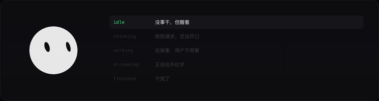

# peepface

**agent 状态的视觉词汇表。**

12 KB · 零依赖 · 纯 SVG · Apache-2.0

[](https://www.npmjs.com/package/peepface)
[](https://github.com/SilasSolivagus/peepface/stargazers)
[](./LICENSE)
[](https://github.com/SilasSolivagus/peepface/commits/main)

**[看 demo →](https://silassolivagus.github.io/peepface/)**　（十二张脸同时在动，鼠标移上去它们会看你）



---

## 为什么

现在做 agent 的人，状态只有三种表达：

```
转圈          三个点        一行小字
◜            ...          正在思考…
```

这三种**都分不清「在干活」和「卡死了」**。用户看着转圈转了三十秒，不知道应该继续等，还是去点一下试试。

peepface 的做法是给 agent 一张脸，让状态变成**形状上的差别**，而不是文字上的：

| 状态 | 一眼看到的是 |
|---|---|
| `working` | 眼睛眯成一条横缝 |
| `blocked` | 身体拉长、眼歪着 —— 过不去 |
| `failed` | 圆脸、眼睛下垂 —— 塌了 |
| `finished` | 弯月笑眼、身体撑开一下 |

不看标签也能分出「在做事」和「出问题了」。这就是全部。

---

## 快速开始

**浏览器**（3 行）：

```html
<script src="https://silassolivagus.github.io/peepface/dist/peepface.js"></script>
<div id="face"></div>
<script>
  peepface.createFace(document.getElementById('face'), { state: 'working' });
</script>
```

**ESM**：

```bash
npm i peepface
```

```js
import { createFace } from 'peepface';

const face = createFace(document.querySelector('#face'), { state: 'idle' });
face.setState('thinking');   // 就这一句
```

它会自己眨眼、呼吸、跟着鼠标看。你只负责告诉它「现在在干什么」。

---

## 十二个生命周期状态

| 状态 | 什么时候用 | 视觉上靠什么区分 |
|---|---|---|
| `idle` | 没事干，但醒着 | 正圆 + 竖眼 + 缓慢漂移 |
| `listening` | 用户在打字，我在等 | 眼位前倾 |
| `thinking` | 收到请求，还没开口 | 形体变不规则 + 轨道环 |
| `searching` | 在翻找（检索、读文件） | 眼左右扫视 3.6 Hz |
| `streaming` | 正在往外吐字 | 竖眼 + 呼吸加快 |
| `working` | 在做事，用户不用管 | **眼睛眯成横缝** |
| `waiting` | 等你决定（审批、选择） | 侧看 + 半透明环 |
| `blocked` | 过不去，需要人拉一把 | **身体拉长 + 眼歪 30°** |
| `finished` | 干完了 | 弯月笑眼 + 身体变宽 |
| `failed` | 出错了 | **圆脸 + 眼睛下垂** |
| `sleeping` | 很久没人用 | 眼睛闭成一条线 |
| `waking` | 被叫醒了 | 眼睛猛地放大 |

完整定义在 **[`states.json`](./states.json)**，包括每个状态的 `differs_from`（和谁不像）和 `must_not`（做了什么就毁了）。

---

## 核心不是代码，是这两个字段

```json
"working": {
  "differs_from": {
    "blocked": "不歪、不变形、不冒符号",
    "thinking": "形状是圆，不是 blob"
  },
  "must_not": "加任何「卡住」的视觉信号。那会让人以为出问题了。"
}
```

代码可以从零再写一遍，但这些判断是调出来的：

- `finished` **停留超过 2 秒就变成常态，失去信号价值**
- `sleeping` **在 5 分钟内出现，就不是「睡了」，是「累了」**
- `working` **加任何「卡住」的暗示，用户会以为出问题**

这也是为什么它是「词汇表」而不是「一个库」——**形态可以换，语义必须一致**。

---

## 保留你自己的词汇

现实里没人把状态叫 `working`。你叫 `tool_call`、叫 `executing`、叫 `retrieving`。

`states.json` 里有 `aliases`：

```json
{ "coding": "working", "retrieving": "searching", "done": "finished" }
```

**你保留自己的词，视觉上大家统一。** 不逼人改代码，是它能当规范的前提。

---

## API

```js
const face = peepface.createFace(container, {
  state: 'idle',     // 初始状态
  size: 84,          // 像素
  dark: true,        // 深色主题：白脸黑眼
  follow: true,      // 眼睛跟随鼠标
});

face.setState('working');
face.getState();     // 'working'
face.blink();        // 手动眨一次
face.destroy();      // 卸载，移除全部监听
```

一页可以同时跑多个实例（demo 页就是 12 个）。类型定义在 [`peepface.d.ts`](./peepface.d.ts)。

---

## 视觉上唯一需要知道的一件事

**眼睛是「洞」**——从脸的形状里挖出来，露出的是背景色。

所以背景换什么颜色、什么主题，眼睛都自动是对的：

```js
深色主题 → 白脸 + 黑眼（洞露出深背景）
浅色主题 → 黑脸 + 白眼（洞露出浅背景）
```

脸用页面的文字色，洞用页面的背景色。零配置就跟随了。

---

## 目录

```
├── core.js            唯一引擎（328 行，工厂版可多实例）
├── states.json        词汇表
├── peepface.d.ts      类型定义
├── build.mjs          core.js → dist/
├── dist/
│   ├── peepface.js    浏览器（UMD）
│   ├── peepface.mjs   ESM
│   └── dsh-client.js  DeepSeek Harness 插件
├── adapters/dsh.js    适配层：状态判定 + 拖拽
├── plugin-dsh/        DSH 插件包
└── index.html         demo
```

```bash
node build.mjs      # 改完 core.js 后重新生成 dist/
```

**只改 `core.js`，不要手改 `dist/`。**

---

## 接入新宿主

`adapters/dsh.js` 是一个完整例子：怎么把一个「能画的脸」变成一个「会跟着 agent 状态变的脸」。

核心只有一件事：**把宿主的事件翻译成 `face.setState()`**。

```js
// 事件 → 状态，这张表才是每个宿主真正要写的东西
on('tool_start',  () => face.setState('working'));
on('token',       () => face.setState('streaming'));
on('error',       () => face.setState('failed'));
on('done',        () => face.setState('finished'));
```

欢迎提 PR 加适配器。

---

## 致谢

球面眼睛的几何、眨眼的分段曲线、状态语义的分层，来自对 [Grok Bot](https://x.ai/news/designing-grok-bot) 头像系统的观察与研究。

本项目**不含任何原厂素材**（形状路径、关键帧、配色）。全部代码与参数基于可观察行为重建。

---

## License

[Apache-2.0](./LICENSE)
